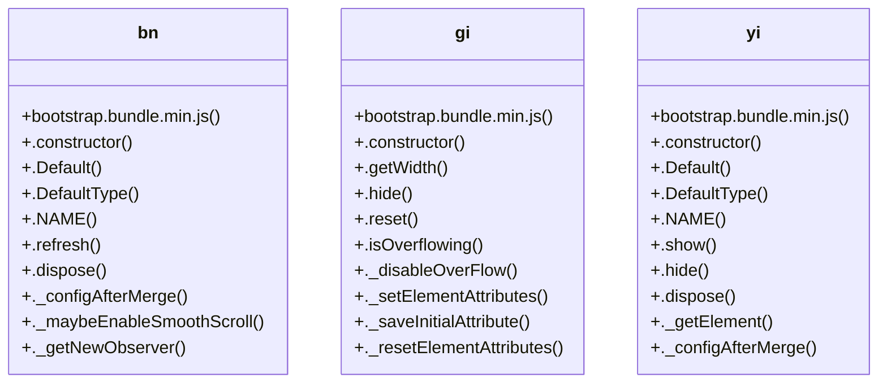

# Community 10

> 182 nodes · cohesion 0.02

## Key Concepts

- [bootstrap.bundle.min.js](file:///Users/gessi/Documents/GitHub/kenz097.github.io/assets/vendor/bootstrap/js/bootstrap.bundle.min.js#L1) (124 connections)
- [gi](file:///Users/gessi/Documents/GitHub/kenz097.github.io/assets/vendor/bootstrap/js/bootstrap.bundle.min.js#L6) (24 connections)
- [bn](file:///Users/gessi/Documents/GitHub/kenz097.github.io/assets/vendor/bootstrap/js/bootstrap.bundle.min.js#L6) (16 connections)
- [e()](file:///Users/gessi/Documents/GitHub/kenz097.github.io/assets/vendor/bootstrap/js/bootstrap.bundle.min.js#L6) (16 connections)
- [le()](file:///Users/gessi/Documents/GitHub/kenz097.github.io/assets/vendor/bootstrap/js/bootstrap.bundle.min.js#L6) (15 connections)
- [d()](file:///Users/gessi/Documents/GitHub/kenz097.github.io/assets/vendor/bootstrap/js/bootstrap.bundle.min.js#L6) (14 connections)
- [oe()](file:///Users/gessi/Documents/GitHub/kenz097.github.io/assets/vendor/bootstrap/js/bootstrap.bundle.min.js#L6) (14 connections)
- [u()](file:///Users/gessi/Documents/GitHub/kenz097.github.io/assets/vendor/bootstrap/js/bootstrap.bundle.min.js#L6) (13 connections)
- [ze()](file:///Users/gessi/Documents/GitHub/kenz097.github.io/assets/vendor/bootstrap/js/bootstrap.bundle.min.js#L6) (13 connections)
- [Bt()](file:///Users/gessi/Documents/GitHub/kenz097.github.io/assets/vendor/bootstrap/js/bootstrap.bundle.min.js#L6) (12 connections)
- [Gt()](file:///Users/gessi/Documents/GitHub/kenz097.github.io/assets/vendor/bootstrap/js/bootstrap.bundle.min.js#L6) (12 connections)
- [o()](file:///Users/gessi/Documents/GitHub/kenz097.github.io/assets/vendor/bootstrap/js/bootstrap.bundle.min.js#L6) (12 connections)
- [te()](file:///Users/gessi/Documents/GitHub/kenz097.github.io/assets/vendor/bootstrap/js/bootstrap.bundle.min.js#L6) (12 connections)
- [xe()](file:///Users/gessi/Documents/GitHub/kenz097.github.io/assets/vendor/bootstrap/js/bootstrap.bundle.min.js#L6) (12 connections)
- [yi](file:///Users/gessi/Documents/GitHub/kenz097.github.io/assets/vendor/bootstrap/js/bootstrap.bundle.min.js#L6) (12 connections)
- [._getConfig()](file:///Users/gessi/Documents/GitHub/kenz097.github.io/assets/vendor/bootstrap/js/bootstrap.bundle.min.js#L6) (11 connections)
- [zt()](file:///Users/gessi/Documents/GitHub/kenz097.github.io/assets/vendor/bootstrap/js/bootstrap.bundle.min.js#L6) (10 connections)
- [ci](file:///Users/gessi/Documents/GitHub/kenz097.github.io/assets/vendor/bootstrap/js/bootstrap.bundle.min.js#L6) (9 connections)
- [ae()](file:///Users/gessi/Documents/GitHub/kenz097.github.io/assets/vendor/bootstrap/js/bootstrap.bundle.min.js#L6) (8 connections)
- [f](file:///Users/gessi/Documents/GitHub/kenz097.github.io/assets/vendor/bootstrap/js/bootstrap.bundle.min.js#L6) (8 connections)
- [fe()](file:///Users/gessi/Documents/GitHub/kenz097.github.io/assets/vendor/bootstrap/js/bootstrap.bundle.min.js#L6) (8 connections)
- [ie()](file:///Users/gessi/Documents/GitHub/kenz097.github.io/assets/vendor/bootstrap/js/bootstrap.bundle.min.js#L6) (8 connections)
- [ne()](file:///Users/gessi/Documents/GitHub/kenz097.github.io/assets/vendor/bootstrap/js/bootstrap.bundle.min.js#L6) (8 connections)
- [we()](file:///Users/gessi/Documents/GitHub/kenz097.github.io/assets/vendor/bootstrap/js/bootstrap.bundle.min.js#L6) (8 connections)
- [ce()](file:///Users/gessi/Documents/GitHub/kenz097.github.io/assets/vendor/bootstrap/js/bootstrap.bundle.min.js#L6) (7 connections)
- *... and 157 more nodes in this community*

## Class Diagram

## Relationships

- No strong cross-community connections detected

## Source Files

- [/Users/gessi/Documents/GitHub/kenz097.github.io/assets/vendor/bootstrap/js/bootstrap.bundle.min.js](file:///Users/gessi/Documents/GitHub/kenz097.github.io/assets/vendor/bootstrap/js/bootstrap.bundle.min.js)
- [/Users/gessi/Documents/GitHub/kenz097.github.io/assets/vendor/bootstrap/js/bootstrap.min.js](file:///Users/gessi/Documents/GitHub/kenz097.github.io/assets/vendor/bootstrap/js/bootstrap.min.js)

## Audit Trail

- EXTRACTED: 741 (96%)
- INFERRED: 27 (4%)
- AMBIGUOUS: 0 (0%)

---

*Part of the graphify knowledge wiki. See [[index]] to navigate.*