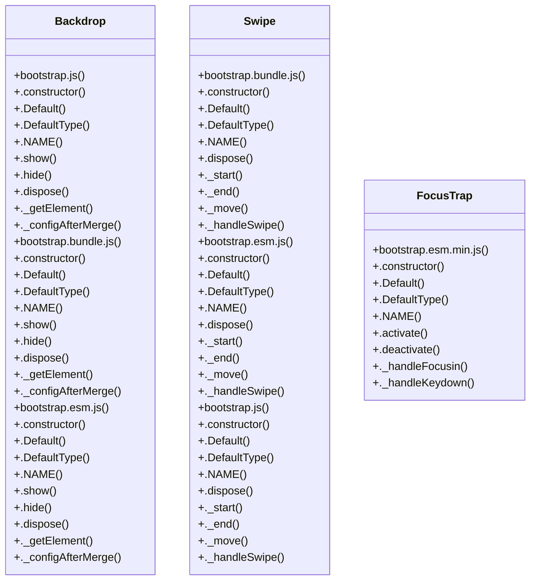

# Community 11

> 119 nodes · cohesion 0.03

## Key Concepts

- [on](file:///Users/gessi/Documents/GitHub/kenz097.github.io/assets/vendor/bootstrap/js/bootstrap.bundle.min.js#L6) (87 connections)
- [off()](file:///Users/gessi/Documents/GitHub/kenz097.github.io/assets/vendor/swiper/swiper-bundle.min.js#L13) (71 connections)
- [Swipe](file:///Users/gessi/Documents/GitHub/kenz097.github.io/assets/vendor/bootstrap/js/bootstrap.bundle.js#L1132) (13 connections)
- [Swipe](file:///Users/gessi/Documents/GitHub/kenz097.github.io/assets/vendor/bootstrap/js/bootstrap.esm.js#L1128) (13 connections)
- [z](file:///Users/gessi/Documents/GitHub/kenz097.github.io/assets/vendor/bootstrap/js/bootstrap.min.js#L6) (13 connections)
- [Swipe](file:///Users/gessi/Documents/GitHub/kenz097.github.io/assets/vendor/bootstrap/js/bootstrap.js#L1152) (13 connections)
- [Backdrop](file:///Users/gessi/Documents/GitHub/kenz097.github.io/assets/vendor/bootstrap/js/bootstrap.js#L2576) (12 connections)
- [Backdrop](file:///Users/gessi/Documents/GitHub/kenz097.github.io/assets/vendor/bootstrap/js/bootstrap.bundle.js#L4402) (12 connections)
- [Backdrop](file:///Users/gessi/Documents/GitHub/kenz097.github.io/assets/vendor/bootstrap/js/bootstrap.esm.js#L2552) (12 connections)
- [FocusTrap](file:///Users/gessi/Documents/GitHub/kenz097.github.io/assets/vendor/bootstrap/js/bootstrap.esm.min.js#L6) (9 connections)
- [.show()](file:///Users/gessi/Documents/GitHub/kenz097.github.io/assets/vendor/bootstrap/js/bootstrap.js#L2598) (6 connections)
- [.show()](file:///Users/gessi/Documents/GitHub/kenz097.github.io/assets/vendor/bootstrap/js/bootstrap.bundle.js#L4424) (6 connections)
- [execute()](file:///Users/gessi/Documents/GitHub/kenz097.github.io/assets/vendor/bootstrap/js/bootstrap.bundle.js#L263) (6 connections)
- [.show()](file:///Users/gessi/Documents/GitHub/kenz097.github.io/assets/vendor/bootstrap/js/bootstrap.esm.js#L2574) (6 connections)
- [execute()](file:///Users/gessi/Documents/GitHub/kenz097.github.io/assets/vendor/bootstrap/js/bootstrap.esm.js#L259) (6 connections)
- [.deactivate()](file:///Users/gessi/Documents/GitHub/kenz097.github.io/assets/vendor/bootstrap/js/bootstrap.esm.min.js#L6) (6 connections)
- [execute()](file:///Users/gessi/Documents/GitHub/kenz097.github.io/assets/vendor/bootstrap/js/bootstrap.js#L283) (6 connections)
- [._emulateAnimation()](file:///Users/gessi/Documents/GitHub/kenz097.github.io/assets/vendor/bootstrap/js/bootstrap.js#L2682) (5 connections)
- [._getElement()](file:///Users/gessi/Documents/GitHub/kenz097.github.io/assets/vendor/bootstrap/js/bootstrap.js#L2646) (5 connections)
- [._emulateAnimation()](file:///Users/gessi/Documents/GitHub/kenz097.github.io/assets/vendor/bootstrap/js/bootstrap.bundle.js#L4508) (5 connections)
- [._getElement()](file:///Users/gessi/Documents/GitHub/kenz097.github.io/assets/vendor/bootstrap/js/bootstrap.bundle.js#L4472) (5 connections)
- [executeAfterTransition()](file:///Users/gessi/Documents/GitHub/kenz097.github.io/assets/vendor/bootstrap/js/bootstrap.bundle.js#L269) (5 connections)
- [._emulateAnimation()](file:///Users/gessi/Documents/GitHub/kenz097.github.io/assets/vendor/bootstrap/js/bootstrap.esm.js#L2658) (5 connections)
- [._getElement()](file:///Users/gessi/Documents/GitHub/kenz097.github.io/assets/vendor/bootstrap/js/bootstrap.esm.js#L2622) (5 connections)
- [executeAfterTransition()](file:///Users/gessi/Documents/GitHub/kenz097.github.io/assets/vendor/bootstrap/js/bootstrap.esm.js#L265) (5 connections)
- *... and 94 more nodes in this community*

## Class Diagram

## Relationships

- No strong cross-community connections detected

## Source Files

- [/Users/gessi/Documents/GitHub/kenz097.github.io/assets/vendor/bootstrap/js/bootstrap.bundle.js](file:///Users/gessi/Documents/GitHub/kenz097.github.io/assets/vendor/bootstrap/js/bootstrap.bundle.js)
- [/Users/gessi/Documents/GitHub/kenz097.github.io/assets/vendor/bootstrap/js/bootstrap.bundle.min.js](file:///Users/gessi/Documents/GitHub/kenz097.github.io/assets/vendor/bootstrap/js/bootstrap.bundle.min.js)
- [/Users/gessi/Documents/GitHub/kenz097.github.io/assets/vendor/bootstrap/js/bootstrap.esm.js](file:///Users/gessi/Documents/GitHub/kenz097.github.io/assets/vendor/bootstrap/js/bootstrap.esm.js)
- [/Users/gessi/Documents/GitHub/kenz097.github.io/assets/vendor/bootstrap/js/bootstrap.esm.min.js](file:///Users/gessi/Documents/GitHub/kenz097.github.io/assets/vendor/bootstrap/js/bootstrap.esm.min.js)
- [/Users/gessi/Documents/GitHub/kenz097.github.io/assets/vendor/bootstrap/js/bootstrap.js](file:///Users/gessi/Documents/GitHub/kenz097.github.io/assets/vendor/bootstrap/js/bootstrap.js)
- [/Users/gessi/Documents/GitHub/kenz097.github.io/assets/vendor/bootstrap/js/bootstrap.min.js](file:///Users/gessi/Documents/GitHub/kenz097.github.io/assets/vendor/bootstrap/js/bootstrap.min.js)
- [/Users/gessi/Documents/GitHub/kenz097.github.io/assets/vendor/swiper/swiper-bundle.min.js](file:///Users/gessi/Documents/GitHub/kenz097.github.io/assets/vendor/swiper/swiper-bundle.min.js)

## Audit Trail

- EXTRACTED: 397 (70%)
- INFERRED: 173 (30%)
- AMBIGUOUS: 0 (0%)

---

*Part of the graphify knowledge wiki. See [[index]] to navigate.*