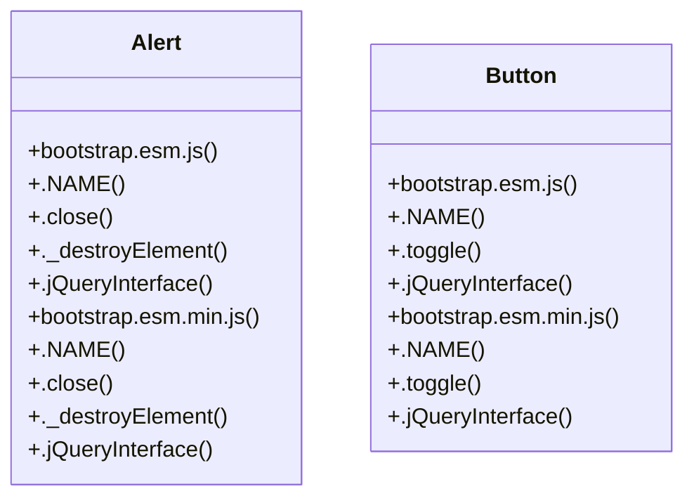

# Community 12

> 115 nodes · cohesion 0.03

## Key Concepts

- [each()](file:///Users/gessi/Documents/GitHub/kenz097.github.io/assets/vendor/glightbox/js/glightbox.js#L76) (86 connections)
- [closest()](file:///Users/gessi/Documents/GitHub/kenz097.github.io/assets/vendor/glightbox/js/glightbox.js#L198) (60 connections)
- [glightbox.js](file:///Users/gessi/Documents/GitHub/kenz097.github.io/assets/vendor/glightbox/js/glightbox.js#L1) (58 connections)
- [has()](file:///Users/gessi/Documents/GitHub/kenz097.github.io/assets/vendor/glightbox/js/glightbox.js#L505) (25 connections)
- [.getOrCreateInstance()](file:///Users/gessi/Documents/GitHub/kenz097.github.io/assets/vendor/bootstrap/js/bootstrap.bundle.js#L836) (18 connections)
- [.getOrCreateInstance()](file:///Users/gessi/Documents/GitHub/kenz097.github.io/assets/vendor/bootstrap/js/bootstrap.esm.js#L832) (18 connections)
- [.getOrCreateInstance()](file:///Users/gessi/Documents/GitHub/kenz097.github.io/assets/vendor/bootstrap/js/bootstrap.esm.min.js#L6) (18 connections)
- [noframework.waypoints.js](file:///Users/gessi/Documents/GitHub/kenz097.github.io/assets/vendor/waypoints/noframework.waypoints.js#L1) (13 connections)
- [addClass()](file:///Users/gessi/Documents/GitHub/kenz097.github.io/assets/vendor/glightbox/js/glightbox.js#L185) (12 connections)
- [removeClass()](file:///Users/gessi/Documents/GitHub/kenz097.github.io/assets/vendor/glightbox/js/glightbox.js#L190) (10 connections)
- [extend()](file:///Users/gessi/Documents/GitHub/kenz097.github.io/assets/vendor/glightbox/js/glightbox.js#L46) (9 connections)
- [resetSlideMove()](file:///Users/gessi/Documents/GitHub/kenz097.github.io/assets/vendor/glightbox/js/glightbox.js#L1040) (9 connections)
- [slideInline()](file:///Users/gessi/Documents/GitHub/kenz097.github.io/assets/vendor/glightbox/js/glightbox.js#L1852) (9 connections)
- [touchNavigation()](file:///Users/gessi/Documents/GitHub/kenz097.github.io/assets/vendor/glightbox/js/glightbox.js#L1067) (9 connections)
- [addEvent()](file:///Users/gessi/Documents/GitHub/kenz097.github.io/assets/vendor/glightbox/js/glightbox.js#L130) (8 connections)
- [_classCallCheck()](file:///Users/gessi/Documents/GitHub/kenz097.github.io/assets/vendor/glightbox/js/glightbox.js#L23) (8 connections)
- [isArray()](file:///Users/gessi/Documents/GitHub/kenz097.github.io/assets/vendor/glightbox/js/glightbox.js#L491) (8 connections)
- [isFunction()](file:///Users/gessi/Documents/GitHub/kenz097.github.io/assets/vendor/glightbox/js/glightbox.js#L482) (8 connections)
- [slideVideo()](file:///Users/gessi/Documents/GitHub/kenz097.github.io/assets/vendor/glightbox/js/glightbox.js#L1778) (8 connections)
- [animateElement()](file:///Users/gessi/Documents/GitHub/kenz097.github.io/assets/vendor/glightbox/js/glightbox.js#L213) (7 connections)
- [isObject()](file:///Users/gessi/Documents/GitHub/kenz097.github.io/assets/vendor/glightbox/js/glightbox.js#L497) (7 connections)
- [injectAssets()](file:///Users/gessi/Documents/GitHub/kenz097.github.io/assets/vendor/glightbox/js/glightbox.js#L383) (6 connections)
- [keyboardNavigation()](file:///Users/gessi/Documents/GitHub/kenz097.github.io/assets/vendor/glightbox/js/glightbox.js#L567) (6 connections)
- [Alert](file:///Users/gessi/Documents/GitHub/kenz097.github.io/assets/vendor/bootstrap/js/bootstrap.esm.js#L901) (5 connections)
- [Alert](file:///Users/gessi/Documents/GitHub/kenz097.github.io/assets/vendor/bootstrap/js/bootstrap.esm.min.js#L6) (5 connections)
- *... and 90 more nodes in this community*

## Class Diagram

## Relationships

- No strong cross-community connections detected

## Source Files

- [/Users/gessi/Documents/GitHub/kenz097.github.io/assets/vendor/bootstrap/js/bootstrap.bundle.js](file:///Users/gessi/Documents/GitHub/kenz097.github.io/assets/vendor/bootstrap/js/bootstrap.bundle.js)
- [/Users/gessi/Documents/GitHub/kenz097.github.io/assets/vendor/bootstrap/js/bootstrap.esm.js](file:///Users/gessi/Documents/GitHub/kenz097.github.io/assets/vendor/bootstrap/js/bootstrap.esm.js)
- [/Users/gessi/Documents/GitHub/kenz097.github.io/assets/vendor/bootstrap/js/bootstrap.esm.min.js](file:///Users/gessi/Documents/GitHub/kenz097.github.io/assets/vendor/bootstrap/js/bootstrap.esm.min.js)
- [/Users/gessi/Documents/GitHub/kenz097.github.io/assets/vendor/glightbox/js/glightbox.js](file:///Users/gessi/Documents/GitHub/kenz097.github.io/assets/vendor/glightbox/js/glightbox.js)
- [/Users/gessi/Documents/GitHub/kenz097.github.io/assets/vendor/isotope-layout/isotope.pkgd.js](file:///Users/gessi/Documents/GitHub/kenz097.github.io/assets/vendor/isotope-layout/isotope.pkgd.js)
- [/Users/gessi/Documents/GitHub/kenz097.github.io/assets/vendor/swiper/swiper-bundle.min.js](file:///Users/gessi/Documents/GitHub/kenz097.github.io/assets/vendor/swiper/swiper-bundle.min.js)
- [/Users/gessi/Documents/GitHub/kenz097.github.io/assets/vendor/waypoints/noframework.waypoints.js](file:///Users/gessi/Documents/GitHub/kenz097.github.io/assets/vendor/waypoints/noframework.waypoints.js)

## Audit Trail

- EXTRACTED: 451 (69%)
- INFERRED: 205 (31%)
- AMBIGUOUS: 0 (0%)

---

*Part of the graphify knowledge wiki. See [[index]] to navigate.*