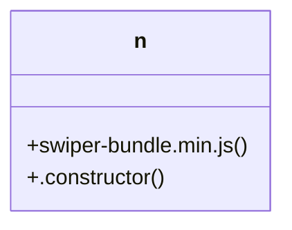

# Community 13

> 81 nodes · cohesion 0.04

## Key Concepts

- [swiper-bundle.min.js](file:///Users/gessi/Documents/GitHub/kenz097.github.io/assets/vendor/swiper/swiper-bundle.min.js#L1) (62 connections)
- [v()](file:///Users/gessi/Documents/GitHub/kenz097.github.io/assets/vendor/swiper/swiper-bundle.min.js#L13) (20 connections)
- [emit()](file:///Users/gessi/Documents/GitHub/kenz097.github.io/assets/vendor/swiper/swiper-bundle.min.js#L13) (16 connections)
- [.constructor()](file:///Users/gessi/Documents/GitHub/kenz097.github.io/assets/vendor/swiper/swiper-bundle.min.js#L13) (12 connections)
- [a()](file:///Users/gessi/Documents/GitHub/kenz097.github.io/assets/vendor/swiper/swiper-bundle.min.js#L13) (11 connections)
- [d()](file:///Users/gessi/Documents/GitHub/kenz097.github.io/assets/vendor/swiper/swiper-bundle.min.js#L13) (9 connections)
- [.update()](file:///Users/gessi/Documents/GitHub/kenz097.github.io/assets/vendor/swiper/swiper-bundle.min.js#L13) (9 connections)
- [l()](file:///Users/gessi/Documents/GitHub/kenz097.github.io/assets/vendor/swiper/swiper-bundle.min.js#L13) (8 connections)
- [r()](file:///Users/gessi/Documents/GitHub/kenz097.github.io/assets/vendor/swiper/swiper-bundle.min.js#L13) (8 connections)
- [g()](file:///Users/gessi/Documents/GitHub/kenz097.github.io/assets/vendor/swiper/swiper-bundle.min.js#L13) (7 connections)
- [.changeDirection()](file:///Users/gessi/Documents/GitHub/kenz097.github.io/assets/vendor/swiper/swiper-bundle.min.js#L13) (7 connections)
- [t()](file:///Users/gessi/Documents/GitHub/kenz097.github.io/assets/vendor/swiper/swiper-bundle.min.js#L13) (6 connections)
- [u()](file:///Users/gessi/Documents/GitHub/kenz097.github.io/assets/vendor/swiper/swiper-bundle.min.js#L13) (6 connections)
- [e()](file:///Users/gessi/Documents/GitHub/kenz097.github.io/assets/vendor/swiper/swiper-bundle.min.js#L13) (5 connections)
- [o()](file:///Users/gessi/Documents/GitHub/kenz097.github.io/assets/vendor/swiper/swiper-bundle.min.js#L13) (5 connections)
- [.init()](file:///Users/gessi/Documents/GitHub/kenz097.github.io/assets/vendor/swiper/swiper-bundle.min.js#L13) (5 connections)
- [.mount()](file:///Users/gessi/Documents/GitHub/kenz097.github.io/assets/vendor/swiper/swiper-bundle.min.js#L13) (5 connections)
- [c](file:///Users/gessi/Documents/GitHub/kenz097.github.io/assets/vendor/swiper/swiper-bundle.min.js#L13) (4 connections)
- [i](file:///Users/gessi/Documents/GitHub/kenz097.github.io/assets/vendor/swiper/swiper-bundle.min.js#L13) (4 connections)
- [f()](file:///Users/gessi/Documents/GitHub/kenz097.github.io/assets/vendor/swiper/swiper-bundle.min.js#L13) (3 connections)
- [h()](file:///Users/gessi/Documents/GitHub/kenz097.github.io/assets/vendor/swiper/swiper-bundle.min.js#L13) (3 connections)
- [p()](file:///Users/gessi/Documents/GitHub/kenz097.github.io/assets/vendor/swiper/swiper-bundle.min.js#L13) (3 connections)
- [q()](file:///Users/gessi/Documents/GitHub/kenz097.github.io/assets/vendor/swiper/swiper-bundle.min.js#L13) (3 connections)
- [.emitContainerClasses()](file:///Users/gessi/Documents/GitHub/kenz097.github.io/assets/vendor/swiper/swiper-bundle.min.js#L13) (3 connections)
- [.emitSlidesClasses()](file:///Users/gessi/Documents/GitHub/kenz097.github.io/assets/vendor/swiper/swiper-bundle.min.js#L13) (3 connections)
- *... and 56 more nodes in this community*

## Class Diagram

## Relationships

- No strong cross-community connections detected

## Source Files

- [/Users/gessi/Documents/GitHub/kenz097.github.io/assets/vendor/glightbox/js/glightbox.js](file:///Users/gessi/Documents/GitHub/kenz097.github.io/assets/vendor/glightbox/js/glightbox.js)
- [/Users/gessi/Documents/GitHub/kenz097.github.io/assets/vendor/swiper/swiper-bundle.min.js](file:///Users/gessi/Documents/GitHub/kenz097.github.io/assets/vendor/swiper/swiper-bundle.min.js)

## Audit Trail

- EXTRACTED: 290 (96%)
- INFERRED: 13 (4%)
- AMBIGUOUS: 0 (0%)

---

*Part of the graphify knowledge wiki. See [[index]] to navigate.*