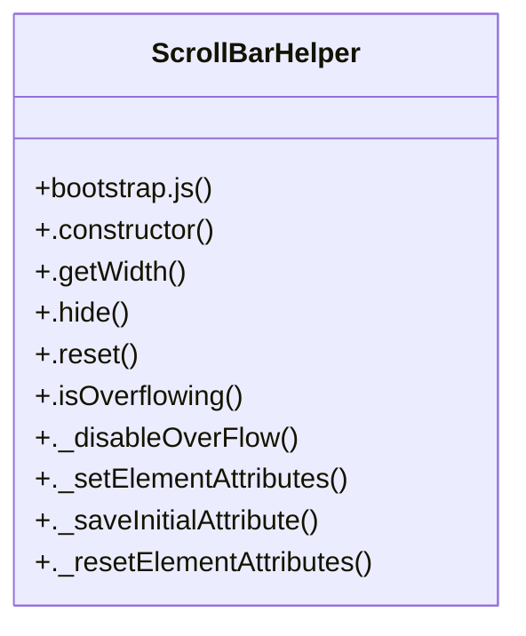

# Community 18

> 11 nodes · cohesion 0.35

## Key Concepts

- [ScrollBarHelper](file:///Users/gessi/Documents/GitHub/kenz097.github.io/assets/vendor/bootstrap/js/bootstrap.js#L2441) (11 connections)
- [.getWidth()](file:///Users/gessi/Documents/GitHub/kenz097.github.io/assets/vendor/bootstrap/js/bootstrap.js#L2447) (5 connections)
- [._applyManipulationCallback()](file:///Users/gessi/Documents/GitHub/kenz097.github.io/assets/vendor/bootstrap/js/bootstrap.js#L2529) (4 connections)
- [.hide()](file:///Users/gessi/Documents/GitHub/kenz097.github.io/assets/vendor/bootstrap/js/bootstrap.js#L2453) (4 connections)
- [._setElementAttributes()](file:///Users/gessi/Documents/GitHub/kenz097.github.io/assets/vendor/bootstrap/js/bootstrap.js#L2488) (4 connections)
- [._disableOverFlow()](file:///Users/gessi/Documents/GitHub/kenz097.github.io/assets/vendor/bootstrap/js/bootstrap.js#L2482) (3 connections)
- [._resetElementAttributes()](file:///Users/gessi/Documents/GitHub/kenz097.github.io/assets/vendor/bootstrap/js/bootstrap.js#L2513) (3 connections)
- [.isOverflowing()](file:///Users/gessi/Documents/GitHub/kenz097.github.io/assets/vendor/bootstrap/js/bootstrap.js#L2477) (2 connections)
- [.reset()](file:///Users/gessi/Documents/GitHub/kenz097.github.io/assets/vendor/bootstrap/js/bootstrap.js#L2467) (2 connections)
- [._saveInitialAttribute()](file:///Users/gessi/Documents/GitHub/kenz097.github.io/assets/vendor/bootstrap/js/bootstrap.js#L2505) (2 connections)
- [.constructor()](file:///Users/gessi/Documents/GitHub/kenz097.github.io/assets/vendor/bootstrap/js/bootstrap.js#L2442) (1 connections)

## Class Diagram

## Relationships

- No strong cross-community connections detected

## Source Files

- [/Users/gessi/Documents/GitHub/kenz097.github.io/assets/vendor/bootstrap/js/bootstrap.js](file:///Users/gessi/Documents/GitHub/kenz097.github.io/assets/vendor/bootstrap/js/bootstrap.js)

## Audit Trail

- EXTRACTED: 41 (100%)
- INFERRED: 0 (0%)
- AMBIGUOUS: 0 (0%)

---

*Part of the graphify knowledge wiki. See [[index]] to navigate.*