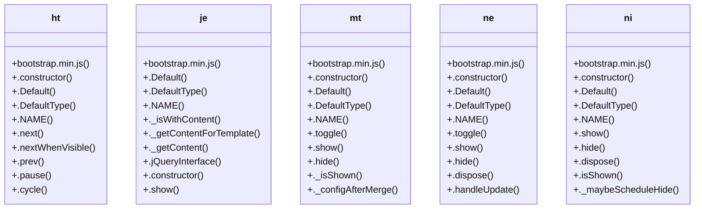

# Community 4

> 318 nodes · cohesion 0.01

## Key Concepts

- [contains()](file:///Users/gessi/Documents/GitHub/kenz097.github.io/assets/vendor/bootstrap/js/bootstrap.bundle.js#L2210) (140 connections)
- [bootstrap.min.js](file:///Users/gessi/Documents/GitHub/kenz097.github.io/assets/vendor/bootstrap/js/bootstrap.min.js#L1) (84 connections)
- [pe](file:///Users/gessi/Documents/GitHub/kenz097.github.io/assets/vendor/bootstrap/js/bootstrap.min.js#L6) (38 connections)
- [ht](file:///Users/gessi/Documents/GitHub/kenz097.github.io/assets/vendor/bootstrap/js/bootstrap.min.js#L6) (37 connections)
- [mt](file:///Users/gessi/Documents/GitHub/kenz097.github.io/assets/vendor/bootstrap/js/bootstrap.min.js#L6) (27 connections)
- [je](file:///Users/gessi/Documents/GitHub/kenz097.github.io/assets/vendor/bootstrap/js/bootstrap.min.js#L6) (23 connections)
- [.destroy()](file:///Users/gessi/Documents/GitHub/kenz097.github.io/assets/vendor/swiper/swiper-bundle.min.js#L13) (21 connections)
- [ne](file:///Users/gessi/Documents/GitHub/kenz097.github.io/assets/vendor/bootstrap/js/bootstrap.min.js#L6) (20 connections)
- [v()](file:///Users/gessi/Documents/GitHub/kenz097.github.io/assets/vendor/bootstrap/js/bootstrap.min.js#L6) (17 connections)
- [._queueCallback()](file:///Users/gessi/Documents/GitHub/kenz097.github.io/assets/vendor/bootstrap/js/bootstrap.min.js#L6) (17 connections)
- [be](file:///Users/gessi/Documents/GitHub/kenz097.github.io/assets/vendor/bootstrap/js/bootstrap.min.js#L6) (16 connections)
- [e()](file:///Users/gessi/Documents/GitHub/kenz097.github.io/assets/vendor/bootstrap/js/bootstrap.min.js#L6) (16 connections)
- [._slide()](file:///Users/gessi/Documents/GitHub/kenz097.github.io/assets/vendor/bootstrap/js/bootstrap.min.js#L6) (16 connections)
- [r()](file:///Users/gessi/Documents/GitHub/kenz097.github.io/assets/vendor/bootstrap/js/bootstrap.min.js#L6) (16 connections)
- [.getOrCreateInstance()](file:///Users/gessi/Documents/GitHub/kenz097.github.io/assets/vendor/bootstrap/js/bootstrap.min.js#L6) (16 connections)
- [ae](file:///Users/gessi/Documents/GitHub/kenz097.github.io/assets/vendor/bootstrap/js/bootstrap.min.js#L6) (15 connections)
- [ni](file:///Users/gessi/Documents/GitHub/kenz097.github.io/assets/vendor/bootstrap/js/bootstrap.min.js#L6) (14 connections)
- [.hide()](file:///Users/gessi/Documents/GitHub/kenz097.github.io/assets/vendor/bootstrap/js/bootstrap.min.js#L6) (12 connections)
- [.show()](file:///Users/gessi/Documents/GitHub/kenz097.github.io/assets/vendor/bootstrap/js/bootstrap.min.js#L6) (12 connections)
- [._isShown()](file:///Users/gessi/Documents/GitHub/kenz097.github.io/assets/vendor/bootstrap/js/bootstrap.min.js#L6) (12 connections)
- [vt](file:///Users/gessi/Documents/GitHub/kenz097.github.io/assets/vendor/bootstrap/js/bootstrap.min.js#L6) (12 connections)
- [.show()](file:///Users/gessi/Documents/GitHub/kenz097.github.io/assets/vendor/bootstrap/js/bootstrap.min.js#L6) (11 connections)
- [._getConfig()](file:///Users/gessi/Documents/GitHub/kenz097.github.io/assets/vendor/bootstrap/js/bootstrap.min.js#L6) (11 connections)
- [.show()](file:///Users/gessi/Documents/GitHub/kenz097.github.io/assets/vendor/bootstrap/js/bootstrap.min.js#L6) (11 connections)
- [c()](file:///Users/gessi/Documents/GitHub/kenz097.github.io/assets/vendor/bootstrap/js/bootstrap.min.js#L6) (10 connections)
- *... and 293 more nodes in this community*

## Class Diagram

## Relationships

- No strong cross-community connections detected

## Source Files

- [/Users/gessi/Documents/GitHub/kenz097.github.io/assets/vendor/bootstrap/js/bootstrap.bundle.js](file:///Users/gessi/Documents/GitHub/kenz097.github.io/assets/vendor/bootstrap/js/bootstrap.bundle.js)
- [/Users/gessi/Documents/GitHub/kenz097.github.io/assets/vendor/bootstrap/js/bootstrap.min.js](file:///Users/gessi/Documents/GitHub/kenz097.github.io/assets/vendor/bootstrap/js/bootstrap.min.js)
- [/Users/gessi/Documents/GitHub/kenz097.github.io/assets/vendor/swiper/swiper-bundle.min.js](file:///Users/gessi/Documents/GitHub/kenz097.github.io/assets/vendor/swiper/swiper-bundle.min.js)

## Audit Trail

- EXTRACTED: 1285 (87%)
- INFERRED: 200 (13%)
- AMBIGUOUS: 0 (0%)

---

*Part of the graphify knowledge wiki. See [[index]] to navigate.*