# Community 8

> 254 nodes · cohesion 0.02

## Key Concepts

- [Tooltip](file:///Users/gessi/Documents/GitHub/kenz097.github.io/assets/vendor/bootstrap/js/bootstrap.esm.js#L3767) (38 connections)
- [Carousel](file:///Users/gessi/Documents/GitHub/kenz097.github.io/assets/vendor/bootstrap/js/bootstrap.esm.js#L1298) (28 connections)
- [Dropdown](file:///Users/gessi/Documents/GitHub/kenz097.github.io/assets/vendor/bootstrap/js/bootstrap.esm.js#L2034) (22 connections)
- [Modal](file:///Users/gessi/Documents/GitHub/kenz097.github.io/assets/vendor/bootstrap/js/bootstrap.esm.js#L2820) (20 connections)
- [Tab](file:///Users/gessi/Documents/GitHub/kenz097.github.io/assets/vendor/bootstrap/js/bootstrap.esm.js#L4718) (18 connections)
- [._queueCallback()](file:///Users/gessi/Documents/GitHub/kenz097.github.io/assets/vendor/bootstrap/js/bootstrap.esm.js#L814) (17 connections)
- [ScrollSpy](file:///Users/gessi/Documents/GitHub/kenz097.github.io/assets/vendor/bootstrap/js/bootstrap.esm.js#L4433) (16 connections)
- [._slide()](file:///Users/gessi/Documents/GitHub/kenz097.github.io/assets/vendor/bootstrap/js/bootstrap.esm.js#L1506) (15 connections)
- [Collapse](file:///Users/gessi/Documents/GitHub/kenz097.github.io/assets/vendor/bootstrap/js/bootstrap.esm.js#L1718) (15 connections)
- [TemplateFactory](file:///Users/gessi/Documents/GitHub/kenz097.github.io/assets/vendor/bootstrap/js/bootstrap.esm.js#L3566) (15 connections)
- [._isShown()](file:///Users/gessi/Documents/GitHub/kenz097.github.io/assets/vendor/bootstrap/js/bootstrap.esm.js#L4048) (15 connections)
- [Toast](file:///Users/gessi/Documents/GitHub/kenz097.github.io/assets/vendor/bootstrap/js/bootstrap.esm.js#L5029) (14 connections)
- [Offcanvas](file:///Users/gessi/Documents/GitHub/kenz097.github.io/assets/vendor/bootstrap/js/bootstrap.esm.js#L3193) (13 connections)
- [.hide()](file:///Users/gessi/Documents/GitHub/kenz097.github.io/assets/vendor/bootstrap/js/bootstrap.esm.js#L5084) (13 connections)
- [.show()](file:///Users/gessi/Documents/GitHub/kenz097.github.io/assets/vendor/bootstrap/js/bootstrap.esm.js#L5053) (13 connections)
- [BaseComponent](file:///Users/gessi/Documents/GitHub/kenz097.github.io/assets/vendor/bootstrap/js/bootstrap.esm.js#L790) (11 connections)
- [ScrollBarHelper](file:///Users/gessi/Documents/GitHub/kenz097.github.io/assets/vendor/bootstrap/js/bootstrap.esm.js#L2417) (11 connections)
- [._getConfig()](file:///Users/gessi/Documents/GitHub/kenz097.github.io/assets/vendor/bootstrap/js/bootstrap.esm.js#L4211) (11 connections)
- [.show()](file:///Users/gessi/Documents/GitHub/kenz097.github.io/assets/vendor/bootstrap/js/bootstrap.esm.js#L3851) (11 connections)
- [getElement()](file:///Users/gessi/Documents/GitHub/kenz097.github.io/assets/vendor/bootstrap/js/bootstrap.esm.js#L116) (10 connections)
- [.dispose()](file:///Users/gessi/Documents/GitHub/kenz097.github.io/assets/vendor/bootstrap/js/bootstrap.esm.js#L5109) (10 connections)
- [FocusTrap](file:///Users/gessi/Documents/GitHub/kenz097.github.io/assets/vendor/bootstrap/js/bootstrap.esm.js#L2695) (9 connections)
- [isElement()](file:///Users/gessi/Documents/GitHub/kenz097.github.io/assets/vendor/bootstrap/js/bootstrap.esm.js#L104) (9 connections)
- [._isAnimated()](file:///Users/gessi/Documents/GitHub/kenz097.github.io/assets/vendor/bootstrap/js/bootstrap.esm.js#L4044) (9 connections)
- [.hide()](file:///Users/gessi/Documents/GitHub/kenz097.github.io/assets/vendor/bootstrap/js/bootstrap.esm.js#L1825) (8 connections)
- *... and 229 more nodes in this community*

## Class Diagram

```mermaid
classDiagram
    class BaseComponent {
        +bootstrap.esm.js()
        +.constructor()
        +.dispose()
        +._queueCallback()
        +._getConfig()
        +.getInstance()
        +.getOrCreateInstance()
        +.VERSION()
        +.DATA_KEY()
        +.EVENT_KEY()
    }
    class Carousel {
        +bootstrap.esm.js()
        +.constructor()
        +.Default()
        +.DefaultType()
        +.NAME()
        +.next()
        +.nextWhenVisible()
        +.prev()
        +.pause()
        +.cycle()
    }
    class Collapse {
        +bootstrap.esm.js()
        +.constructor()
        +.Default()
        +.DefaultType()
        +.NAME()
        +.toggle()
        +.show()
        +.hide()
        +._isShown()
        +._configAfterMerge()
    }
    class Config {
        +bootstrap.esm.js()
        +.Default()
        +.DefaultType()
        +.NAME()
        +._getConfig()
        +._configAfterMerge()
        +._mergeConfigObj()
        +._typeCheckConfig()
    }
    class Dropdown {
        +bootstrap.esm.js()
        +.constructor()
        +.Default()
        +.DefaultType()
        +.NAME()
        +.toggle()
        +.show()
        +.hide()
        +.dispose()
        +.update()
    }
    class FocusTrap {
        +bootstrap.esm.js()
        +.constructor()
        +.Default()
        +.DefaultType()
        +.NAME()
        +.activate()
        +.deactivate()
        +._handleFocusin()
        +._handleKeydown()
    }
    class Modal {
        +bootstrap.esm.js()
        +.constructor()
        +.Default()
        +.DefaultType()
        +.NAME()
        +.toggle()
        +.show()
        +.hide()
        +.dispose()
        +.handleUpdate()
    }
    class Offcanvas {
        +bootstrap.esm.js()
        +.constructor()
        +.Default()
        +.DefaultType()
        +.NAME()
        +.toggle()
        +.show()
        +.hide()
        +.dispose()
        +._initializeBackDrop()
    }
    class Popover {
        +bootstrap.esm.js()
        +.Default()
        +.DefaultType()
        +.NAME()
        +._isWithContent()
        +._getContentForTemplate()
        +._getContent()
        +.jQueryInterface()
    }
    class ScrollBarHelper {
        +bootstrap.esm.js()
        +.constructor()
        +.getWidth()
        +.hide()
        +.reset()
        +.isOverflowing()
        +._disableOverFlow()
        +._setElementAttributes()
        +._saveInitialAttribute()
        +._resetElementAttributes()
    }
    class ScrollSpy {
        +bootstrap.esm.js()
        +.constructor()
        +.Default()
        +.DefaultType()
        +.NAME()
        +.refresh()
        +.dispose()
        +._configAfterMerge()
        +._maybeEnableSmoothScroll()
        +._getNewObserver()
    }
    class Tab {
        +bootstrap.esm.js()
        +.constructor()
        +.NAME()
        +.show()
        +._activate()
        +._deactivate()
        +._keydown()
        +._getChildren()
        +._getActiveElem()
        +._setInitialAttributes()
    }
    class TemplateFactory {
        +bootstrap.esm.js()
        +.constructor()
        +.Default()
        +.DefaultType()
        +.NAME()
        +.getContent()
        +.hasContent()
        +.changeContent()
        +.toHtml()
        +._typeCheckConfig()
    }
    class Toast {
        +bootstrap.esm.js()
        +.constructor()
        +.Default()
        +.DefaultType()
        +.NAME()
        +.show()
        +.hide()
        +.dispose()
        +.isShown()
        +._maybeScheduleHide()
    }
    class Tooltip {
        +bootstrap.esm.js()
        +.constructor()
        +.Default()
        +.DefaultType()
        +.NAME()
        +.enable()
        +.disable()
        +.toggleEnabled()
        +.toggle()
        +.dispose()
    }
```

## Relationships

- No strong cross-community connections detected

## Source Files

- [/Users/gessi/Documents/GitHub/kenz097.github.io/assets/vendor/bootstrap/js/bootstrap.esm.js](file:///Users/gessi/Documents/GitHub/kenz097.github.io/assets/vendor/bootstrap/js/bootstrap.esm.js)

## Audit Trail

- EXTRACTED: 1033 (95%)
- INFERRED: 59 (5%)
- AMBIGUOUS: 0 (0%)

---

*Part of the graphify knowledge wiki. See [[index]] to navigate.*