# Community 9

> 202 nodes · cohesion 0.02

## Key Concepts

- [cn](file:///Users/gessi/Documents/GitHub/kenz097.github.io/assets/vendor/bootstrap/js/bootstrap.bundle.min.js#L6) (38 connections)
- [at](file:///Users/gessi/Documents/GitHub/kenz097.github.io/assets/vendor/bootstrap/js/bootstrap.bundle.min.js#L6) (28 connections)
- [hi](file:///Users/gessi/Documents/GitHub/kenz097.github.io/assets/vendor/bootstrap/js/bootstrap.bundle.min.js#L6) (22 connections)
- [ni](file:///Users/gessi/Documents/GitHub/kenz097.github.io/assets/vendor/bootstrap/js/bootstrap.bundle.min.js#L6) (20 connections)
- [kn](file:///Users/gessi/Documents/GitHub/kenz097.github.io/assets/vendor/bootstrap/js/bootstrap.bundle.min.js#L6) (18 connections)
- [.getOrCreateInstance()](file:///Users/gessi/Documents/GitHub/kenz097.github.io/assets/vendor/bootstrap/js/bootstrap.bundle.min.js#L6) (18 connections)
- [._queueCallback()](file:///Users/gessi/Documents/GitHub/kenz097.github.io/assets/vendor/bootstrap/js/bootstrap.bundle.min.js#L6) (17 connections)
- [._slide()](file:///Users/gessi/Documents/GitHub/kenz097.github.io/assets/vendor/bootstrap/js/bootstrap.bundle.min.js#L6) (16 connections)
- [._isShown()](file:///Users/gessi/Documents/GitHub/kenz097.github.io/assets/vendor/bootstrap/js/bootstrap.bundle.min.js#L6) (15 connections)
- [pt](file:///Users/gessi/Documents/GitHub/kenz097.github.io/assets/vendor/bootstrap/js/bootstrap.bundle.min.js#L6) (15 connections)
- [r()](file:///Users/gessi/Documents/GitHub/kenz097.github.io/assets/vendor/bootstrap/js/bootstrap.bundle.min.js#L6) (15 connections)
- [pn](file:///Users/gessi/Documents/GitHub/kenz097.github.io/assets/vendor/bootstrap/js/bootstrap.bundle.min.js#L6) (14 connections)
- [.hide()](file:///Users/gessi/Documents/GitHub/kenz097.github.io/assets/vendor/bootstrap/js/bootstrap.bundle.min.js#L6) (13 connections)
- [.show()](file:///Users/gessi/Documents/GitHub/kenz097.github.io/assets/vendor/bootstrap/js/bootstrap.bundle.min.js#L6) (13 connections)
- [zi](file:///Users/gessi/Documents/GitHub/kenz097.github.io/assets/vendor/bootstrap/js/bootstrap.bundle.min.js#L6) (13 connections)
- [.show()](file:///Users/gessi/Documents/GitHub/kenz097.github.io/assets/vendor/bootstrap/js/bootstrap.bundle.min.js#L6) (11 connections)
- [z](file:///Users/gessi/Documents/GitHub/kenz097.github.io/assets/vendor/bootstrap/js/bootstrap.bundle.min.js#L6) (11 connections)
- [n()](file:///Users/gessi/Documents/GitHub/kenz097.github.io/assets/vendor/bootstrap/js/bootstrap.bundle.min.js#L6) (10 connections)
- [.dispose()](file:///Users/gessi/Documents/GitHub/kenz097.github.io/assets/vendor/bootstrap/js/bootstrap.bundle.min.js#L6) (10 connections)
- [._isAnimated()](file:///Users/gessi/Documents/GitHub/kenz097.github.io/assets/vendor/bootstrap/js/bootstrap.bundle.min.js#L6) (9 connections)
- [l()](file:///Users/gessi/Documents/GitHub/kenz097.github.io/assets/vendor/bootstrap/js/bootstrap.bundle.min.js#L6) (9 connections)
- [.dataApiKeydownHandler()](file:///Users/gessi/Documents/GitHub/kenz097.github.io/assets/vendor/bootstrap/js/bootstrap.bundle.min.js#L6) (8 connections)
- [.hide()](file:///Users/gessi/Documents/GitHub/kenz097.github.io/assets/vendor/bootstrap/js/bootstrap.bundle.min.js#L6) (8 connections)
- [un](file:///Users/gessi/Documents/GitHub/kenz097.github.io/assets/vendor/bootstrap/js/bootstrap.bundle.min.js#L6) (8 connections)
- [.hide()](file:///Users/gessi/Documents/GitHub/kenz097.github.io/assets/vendor/bootstrap/js/bootstrap.bundle.min.js#L6) (7 connections)
- *... and 177 more nodes in this community*

## Class Diagram

```mermaid
classDiagram
    class at {
        +bootstrap.bundle.min.js()
        +.constructor()
        +.Default()
        +.DefaultType()
        +.NAME()
        +.next()
        +.nextWhenVisible()
        +.prev()
        +.pause()
        +.cycle()
    }
    class cn {
        +bootstrap.bundle.min.js()
        +.constructor()
        +.Default()
        +.DefaultType()
        +.NAME()
        +.enable()
        +.disable()
        +.toggleEnabled()
        +.toggle()
        +.dispose()
    }
    class hi {
        +bootstrap.bundle.min.js()
        +.constructor()
        +.Default()
        +.DefaultType()
        +.NAME()
        +.toggle()
        +.show()
        +.hide()
        +.dispose()
        +.update()
    }
    class kn {
        +bootstrap.bundle.min.js()
        +.constructor()
        +.NAME()
        +.show()
        +._activate()
        +._deactivate()
        +._keydown()
        +._getChildren()
        +._getActiveElem()
        +._setInitialAttributes()
    }
    class pt {
        +bootstrap.bundle.min.js()
        +.constructor()
        +.Default()
        +.DefaultType()
        +.NAME()
        +.toggle()
        +.show()
        +.hide()
        +._isShown()
        +._configAfterMerge()
    }
    class un {
        +bootstrap.bundle.min.js()
        +.Default()
        +.DefaultType()
        +.NAME()
        +._isWithContent()
        +._getContentForTemplate()
        +._getContent()
        +.jQueryInterface()
    }
    class z {
        +bootstrap.bundle.min.js()
        +.constructor()
        +.dispose()
        +._queueCallback()
        +._getConfig()
        +.getInstance()
        +.getOrCreateInstance()
        +.VERSION()
        +.DATA_KEY()
        +.EVENT_KEY()
    }
    class zi {
        +bootstrap.bundle.min.js()
        +.constructor()
        +.Default()
        +.DefaultType()
        +.NAME()
        +.toggle()
        +.show()
        +.hide()
        +.dispose()
        +._initializeBackDrop()
    }
```

## Relationships

- No strong cross-community connections detected

## Source Files

- [/Users/gessi/Documents/GitHub/kenz097.github.io/assets/vendor/bootstrap/js/bootstrap.bundle.min.js](file:///Users/gessi/Documents/GitHub/kenz097.github.io/assets/vendor/bootstrap/js/bootstrap.bundle.min.js)
- [/Users/gessi/Documents/GitHub/kenz097.github.io/assets/vendor/bootstrap/js/bootstrap.min.js](file:///Users/gessi/Documents/GitHub/kenz097.github.io/assets/vendor/bootstrap/js/bootstrap.min.js)

## Audit Trail

- EXTRACTED: 871 (94%)
- INFERRED: 54 (6%)
- AMBIGUOUS: 0 (0%)

---

*Part of the graphify knowledge wiki. See [[index]] to navigate.*