# Knowledge Graph Index

> Auto-generated by graphify. Start here — read community articles for context, then drill into god nodes for detail.

**3645 nodes · 6624 edges · 23 communities**

---

## System Architecture Flowchart

```mermaid
flowchart TD
    C0["Overlay positioning (415 nodes)"]
    C1["UI Component Library (340 nodes)"]
    C2["Community 2 (335 nodes)"]
    C3["Community 3 (334 nodes)"]
    C4["Community 4 (318 nodes)"]
    C5["Community 5 (268 nodes)"]
    C6["Community 6 (258 nodes)"]
    C7["Community 7 (257 nodes)"]
    C8["Community 8 (254 nodes)"]
    C9["Community 9 (202 nodes)"]
    C10["Community 10 (182 nodes)"]
    C11["Community 11 (119 nodes)"]
    C12["Community 12 (115 nodes)"]
    C13["Community 13 (81 nodes)"]
    C14["Community 14 (61 nodes)"]
    C15["Community 15 (28 nodes)"]
    C16["Community 16 (23 nodes)"]
    C17["Community 17 (21 nodes)"]
    C18["Community 18 (11 nodes)"]
    C19["Community 19 (8 nodes)"]
    C20["Community 20 (8 nodes)"]
    C21["Community 21 (6 nodes)"]
    C22["unknown (1 nodes)"]
    C10 -->|42 edges| C9
    C2 -->|37 edges| C5
    C0 -->|34 edges| C6
    C1 -->|32 edges| C7
    C3 -->|31 edges| C8
    C4 -->|25 edges| C12
    C4 -->|25 edges| C7
    C4 -->|24 edges| C9
    C5 -->|24 edges| C12
    C6 -->|24 edges| C12
    C11 -->|23 edges| C4
    C8 -->|23 edges| C12
    C7 -->|22 edges| C12
    C8 -->|21 edges| C4
    C4 -->|20 edges| C6
    C5 -->|20 edges| C4
    C9 -->|20 edges| C12
    C5 -->|16 edges| C11
    C13 -->|13 edges| C12
    C8 -->|13 edges| C11
    C6 -->|13 edges| C11
    C7 -->|13 edges| C11
    C11 -->|12 edges| C5
    C11 -->|12 edges| C8
    C11 -->|12 edges| C6
    C11 -->|12 edges| C7
    C12 -->|12 edges| C8
    C12 -->|11 edges| C5
    C11 -->|10 edges| C9
    C9 -->|10 edges| C10
    C3 -->|8 edges| C11
    C11 -->|6 edges| C10
    C9 -->|6 edges| C11
    C14 -->|5 edges| C12
    C0 -->|5 edges| C11
    C6 -->|5 edges| C4
    C12 -->|5 edges| C6
    C4 -->|5 edges| C10
    C4 -->|5 edges| C14
    C1 -->|5 edges| C11
    C10 -->|5 edges| C11
    C10 -->|5 edges| C12
    C4 -->|5 edges| C11
    C2 -->|4 edges| C12
    C3 -->|4 edges| C12
    C0 -->|4 edges| C4
    C4 -->|3 edges| C5
    C4 -->|3 edges| C8
    C16 -->|3 edges| C12
    C5 -->|3 edges| C2
    C0 -->|3 edges| C12
    C13 -->|2 edges| C4
    C11 -->|2 edges| C2
    C11 -->|2 edges| C0
    C11 -->|2 edges| C1
    C12 -->|2 edges| C4
    C11 -->|2 edges| C3
    C0 -->|2 edges| C10
    C1 -->|2 edges| C12
    C12 -->|2 edges| C14
    C15 -->|1 edges| C12
    C13 -->|1 edges| C11
    C2 -->|1 edges| C11
    C5 -->|1 edges| C14
    C5 -->|1 edges| C0
    C8 -->|1 edges| C0
    C6 -->|1 edges| C0
    C0 -->|1 edges| C7
    C0 -->|1 edges| C9
    C4 -->|1 edges| C0
    C1 -->|1 edges| C18
    C7 -->|1 edges| C18
    C18 -->|1 edges| C7
    C10 -->|1 edges| C0
    C11 -->|1 edges| C12
    C11 -->|1 edges| C14
    C12 -->|1 edges| C13
```

## Communities
(sorted by size, largest first)

- [[Overlay positioning]] — 415 nodes
- [[UI Component Library]] — 340 nodes
- [[Community 2]] — 335 nodes
- [[Community 3]] — 334 nodes
- [[Community 4]] — 318 nodes
- [[Community 5]] — 268 nodes
- [[Community 6]] — 258 nodes
- [[Community 7]] — 257 nodes
- [[Community 8]] — 254 nodes
- [[Community 9]] — 202 nodes
- [[Community 10]] — 182 nodes
- [[Community 11]] — 119 nodes
- [[Community 12]] — 115 nodes
- [[Community 13]] — 81 nodes
- [[Community 14]] — 61 nodes
- [[Community 15]] — 28 nodes
- [[Community 16]] — 23 nodes
- [[Community 17]] — 21 nodes
- [[Community 18]] — 11 nodes
- [[Community 19]] — 8 nodes
- [[Community 20]] — 8 nodes
- [[Community 21]] — 6 nodes
- [[unknown]] — 1 nodes

## God Nodes
(most connected concepts — the load-bearing abstractions)

- [[contains()]] — 140 connections
- [[on]] — 87 connections
- [[each()]] — 86 connections
- [[off()]] — 71 connections
- [[closest()]] — 60 connections
- [[Tooltip]] — 38 connections
- [[Tooltip]] — 38 connections
- [[Tooltip]] — 38 connections
- [[Tooltip]] — 38 connections
- [[cn]] — 38 connections

---

*Generated by [graphify](https://github.com/safishamsi/graphify)*